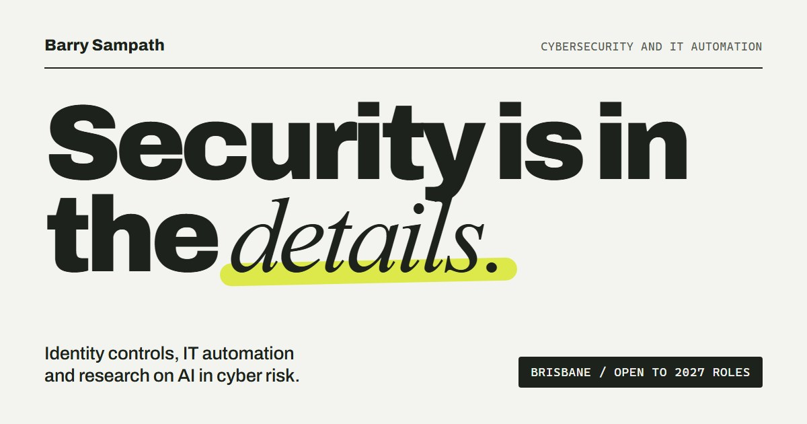

# Barry Sampath | Portfolio

[View the live portfolio](https://bharath-blazecode.github.io/)

[](https://bharath-blazecode.github.io/)

This repository contains the source for my portfolio, a static site built with HTML, CSS and JavaScript.

The website carries the professional story and project detail. This README is for people who want to inspect, run or maintain the code.

## Visit the work

- [ITDR Home Lab](https://bharath-blazecode.github.io/work/homelab/)
- [ClassQuest](https://bharath-blazecode.github.io/work/classquest/)
- [LUNA](https://bharath-blazecode.github.io/work/luna/)
- [Scoreboard: CTFs and hackathon results](https://bharath-blazecode.github.io/work/competitions/)

Each case study separates project context, my contribution and the evidence available for inspection.

## Run locally

Node.js 22 or later is required. Building, serving and the static checks use only the modules that ship with Node, so they do not need an npm install.

| Command | Purpose |
|---|---|
| `npm start` | Build the site and serve it at `http://127.0.0.1:48763` |
| `npm test` | Build into `.tmp/verify` and check links, metadata, safe markup, writing rules and factual safeguards |
| `npm run build` | Check the site and write it to `dist/` |
| `npm run preview` | Serve the finished `dist/` build |

Run `npm run build` before `npm run preview`. Stop either server with Ctrl+C. `npm start` builds once; run it again after editing.

The browser tests need the development dependencies and Chromium:

```sh
npm ci --ignore-scripts
node node_modules/playwright/cli.js install chromium
npm run test:all
```

`npm run test:all` runs every suite in turn: `test:browser`, `test:home`, `test:desk`, `test:terminal`, `test:explainer`, `test:homelab`, `test:classquest`, `test:mobile` and `test:writing`. Each can also be run alone. The suites cover the homepage, the three case studies, the Scoreboard and the 404 page at 320, 390, 820 and 1440px in both themes, plus reduced motion, keyboard use, the no-JavaScript path and printing. Axe is included for automated accessibility checks, but an automated pass does not establish WCAG conformance or replace assistive-technology testing.

## How the site is put together

Pages live in `src/pages` and share one layout, header and footer from `src/partials`. `tools/build.cjs` renders them into `dist/`. Each page starts with a short block that names its title, description, stylesheets and scripts. The build inlines the CSS for each page, so the first paint needs one request, and writes a Content-Security-Policy with hashes for the inline theme script and styles. Navigation is edited in one place, `src/partials/header.html`.

```text
src/pages/                  the six pages: home, 404 and work/*
src/partials/               layout, header, footer and the research explainer
src/data/person.json        JSON-LD for the homepage
src/desk-scene.js           source for the 3D desk (bundled with Three.js into assets/desk/)
css/base.css                design tokens and shared components
css/home.css                homepage sections
css/case.css                case studies, Scoreboard and 404
css/terminal.css            terminal overlay
css/explainer.css           research explainer
js/theme.js                 applies a saved theme before first paint
js/site.js                  theme control, menu, scroll reveals, terminal loader
js/home.js                  desk loading, project folders, responder, chess knight
js/terminal.js              terminal engine; js/terminal-data.js holds its files
js/explainer.js, js/homelab.js, js/classquest.js   page components
assets/                     images, fonts, the desk bundle and still images
resume/                     downloadable resume PDF
tools/                      build, serve, verify, writing check, image and desk helpers
tests/                      Playwright suites
llms.txt                    plain-text summary for tools that read sites
past looks/                 dated screenshots of earlier designs (not published)
```

After editing `src/desk-scene.js`, run `npm run bundle:desk` to rebuild the bundle and the still images. `npm run images` remakes the WebP copies of the screenshots. Three.js 0.187.0 is MIT-licensed; its licence is in `assets/desk/THREE-LICENSE.txt`.

## Design and behaviour

The site opens in the light theme. The header control switches to dark and the choice is remembered on that device only. An inline script applies a saved choice before first paint.

The primary content and navigation are ordinary HTML. There is one header navigation and one mobile menu. Without JavaScript every section, project and role is readable, and the theme and terminal buttons are not shown.

Motion uses `transform` and `opacity` only. Sections fade up with CSS scroll-driven animation where the browser supports it and a one-off class otherwise. The marker stroke under the headline sweeps in once. Project folders fan their two sheets out on hover and keyboard focus. With `prefers-reduced-motion` the page shows its final state and nothing animates.

The desk in Selected work is an original procedural 3D illustration, not a live system. A still image shows first. On a desktop with a mouse the scene loads after the page is idle; on phones and with data saver it loads only when asked. Its objects open the projects, and the same links are in the folders below. A drop of highlighter ink follows a mouse across the desk. The scene draws only when something changes, stops off screen and in background tabs, and falls back to the still image if WebGL is unavailable.

The responder is a small pixel sprite that stands on the at-a-glance list. It plays a short loop and then stays still.

The terminal opens from the header or with the backtick key. It is a simulation: a small virtual filesystem of text written from the pages, with `ls`, `cd`, `cat`, `grep`, pipes, tab completion and history. The files in `logs` are illustrative Sysmon and Wazuh events for the home lab story and say so. Nothing executes, nothing is fetched and visitor input is inserted as text. Commands such as `nmap` and `ssh` explain why they are not run.

The research explainer places three invented evidence samples against the ASD Essentials. It is labelled as an illustration of the research question. It shows no results and nothing in it is the output of a model.

The About section has a chess board where a knight makes one legal move per press.

### Mobile

Small screens are designed, not shrunk. Touch targets are at least 44px, margins are optical, and no page overflows sideways from 320px up. Diagrams on the home lab page are redrawn for narrow screens. `npm run test:mobile` checks these at 320, 360, 390, 430, 768 and 820px in both themes.

### Writing rules

Visible text avoids em and en dashes, arrow characters, middle dots, the ellipsis character, check marks and emoji. External links carry a small icon and the words "(external site)" for screen readers. `tools/check-writing.cjs` runs as part of `npm test`; it fails on a banned character in built pages, this README or `llms.txt`, and warns on a short list of overused words.

### Privacy and security

Fonts, scripts and the 3D scene are self-hosted. The site makes no analytics or third-party requests. Each page carries a Content-Security-Policy and a referrer policy as meta tags; there are no inline event handlers or style attributes.

## Content boundaries

Repository changes should preserve the distinction between completed work, shared work, teaching examples and future plans.

- ITDR Home Lab Phase 1 established endpoint telemetry collection. The lab is paused, and detection-rule development remains future work.
- The animated telemetry path and sample trace are explanatory visuals. They are not live telemetry, a recorded incident or evidence of response time.
- ClassQuest was built by a five-person team, and the People's Choice Award belongs to the team. My individual contribution is supported by the ten linked pull requests.
- ClassQuest PR #12 separated client filenames from server-generated storage names and bounded the application read. Its four added test cases are linked at the merged patch's commit; the existing compatibility test was retained. It did not add malware scanning, parser isolation, upstream request limits or comprehensive upload protection. The page explains historical evidence and does not claim to rerun the team's application tests.
- LUNA is shared work with Zhirui Lu. Individual, shared and vendor contributions should remain attributed.
- DissentKit is presented as an early experiment without a claim of independently established effectiveness.
- The VRES research placement began in November 2026. The description reflects the owner's update: exploring AI assessment against ASD Essentials and helping evaluate its trustworthiness with QUT and Flame Tree Cyber. The work is in progress; do not describe its aims as established results or claim an unpublished acceptance rate.
- Competition results are team results (Team SushiShield for the CTFs; the ClassQuest team for the hackathon), and the notes on the Scoreboard page describe my own work in the first person. ByteMe CTF is a participation certificate with no placement, and nothing may suggest one. Do not describe any event as unaided, solo or fully completed: the Holmes certificate records eight of 111 challenges, and the TryHackMe tabletop score (86% across 15 decisions) is not an overall event score. The "How I worked" note is deliberately general ("AI tools as a guide on some events"); keep it accurate if events are added. Event dates were checked against the organisers' pages (CSAW, TryHackMe, Hack The Box) and the certificates (Holmes, ByteMe) on 29 October 2026. `npm test` pins every result line, so a changed figure fails until it is re-checked against its source.
- Competition evidence in `assets/competitions/` is the owner's own certificates and result screenshots, recompressed. The leaderboard is cropped to its panel; nothing in them is edited. Teammates named on the Scoreboard page (Alan Nguyen, Akira Hasuo) are credited as in the public LinkedIn post.
- The downloadable résumé is stored in `resume/` and linked directly from every masthead, the homepage introduction and the Contact section.

## Build and deployment

`.github/workflows/pages.yml` builds the site and publishes `dist/` to GitHub Pages on each push to `main`. The repository's Pages source must be set to "GitHub Actions" for this to take effect. Only `dist/` is published, so `past looks/`, tests and tools are not served.

Font licence files are included in `assets/fonts/` (Archivo, Source Serif 4 and Cascadia Mono, all under the SIL Open Font License). The repository has no top-level licence, so no blanket reuse permission should be inferred for project screenshots, photographs, diagrams or responder artwork.
